# Atividade em Grupo · Projeto de Evolução do Sistema
**WEB2/LWEB2 · 4º Bimestre · Prof.ª Elizabeth Duane · CEFET-MG Unidade Contagem**  
*(Continuação da Proposta do 3º Bimestre — Projeto de Evolução do Sistema)*

---

| Campo | Informação |
|---|---|
| **Nome do sistema** | Super na Régua |
| **Domínio (do 1º bimestre)** | `https://supernaregua.gamer.gd/index.php` |
| **URL do sistema publicado (4º bimestre)** | `https://supernarregua.free.je/` |
| **Link do vídeo (até 10 min)** | `https://youtu.be/SEU_LINK_AQUI` |
| **Integrante 1** | Luan Henrique Neves Miranda |
| **Integrante 2** | Miguel Silva Rodrigues |
| **Integrante 3** | Rafael Borges Silva |

---

## 1. Identificação e Usuários de Teste

Usuários cadastrados no banco de dados para os testes da avaliação e arguição:

| Perfil | Nome Completo | E-mail | Senha de Teste | Permissão de Acesso |
|---|---|---|---|---|
| Administrador | Administrador | `admin@supernaregua.com` | `123456` | Painel de controle, gerenciar serviços (cadastrar, editar e excluir) |
| Cliente | João Cliente | `joao@email.com` | `123456` | Catálogo, detalhes, agendar serviço e consultar/cancelar agendamentos |
| Cliente | Maria Cliente | `maria@email.com` | `123456` | Catálogo, detalhes, agendar serviço e consultar/cancelar agendamentos |

---

## 2. O que foi implementado

### 2.1 O que foi feito como planejado

Todo o planejamento essencial da proposta do 3º bimestre foi transformado no sistema funcional em MVC:
1. **Arquitetura MVC:** O sistema foi organizado rigorosamente em Model (acesso ao banco com `$pdo` protegido), Controller (lógica das ações e autorização) e View (HTML puro com `htmlspecialchars`), centralizados no Front Controller `index.php` e carregamento via `spl_autoload_register`.
2. **Visitante:** Visualização do catálogo de serviços com filtro por categoria; tela com detalhes completos do serviço e horários; tela de login e tela de cadastro de novos clientes com validação de senhas.
3. **Cliente:** Formulário de agendamento integrado; gravação da solicitação com vínculo obrigatório ao `usuario_id` da sessão; página "Meus Agendamentos" exibindo somente os agendamentos daquele usuário; cancelamento de agendamento via requisição POST com conferência de dono.
4. **Administrador:** Painel de gerenciamento listando todos os serviços; formulário unificado de cadastro e edição com upload de imagens para `assets/`; sincronização de horários com transações; exclusão via POST com proteção de integridade referencial quando existirem agendamentos associados.
5. **Segurança e Camadas:** Todas as consultas preparadas (Prepared Statements via PDO); validação de acessos no servidor impedindo que visitantes ou clientes abram páginas restritas; padrão Post-Redirect-Get (PRG) com mensagens de feedback gravadas na sessão.

### 2.2 O que mudou em relação à proposta e por quê

1. **Migração de scripts procedurais soltos para o Front Controller em MVC:** Na proposta do 3º bimestre, foram projetados scripts individuais como `processar_servico.php` e `excluir_servico.php`. Na implementação prática, todas as requisições foram unificadas no ponto de entrada `index.php?acao=...`, sendo despachadas para métodos de classes controladoras (`UsuarioController`, `ServicoController`, `AgendarController`), atendendo ao padrão MVC exigido na disciplina.
2. **Uso de transações atômicas para integridade dos horários:** Como os serviços possuem horários relacionados na tabela `horarios`, as operações de criação, atualização e exclusão foram encapsuladas em transações PDO (`$pdo->beginTransaction()`, `$pdo->commit()`, `$pdo->rollBack()`) dentro do `ServicoModel`, garantindo que o banco de dados nunca fique com dados inconsistentes caso ocorra uma falha no salvamento.

### 2.3 O que ficou faltando

Nenhum item obrigatório ficou pendente. Todas as funcionalidades das três personas (Visitante, Cliente e Administrador), o controle de acesso no servidor, o banco de dados relacional e as regras técnicas de segurança e camadas foram integralmente implementados e testados.

### 2.4 Recurso Extra Implementado: URLs Amigáveis (`mod_rewrite`)

Foi implementado o arquivo `.htaccess` na raiz do projeto com diretivas `mod_rewrite`, aceitando endereços amigáveis como `/catalogo`, `/detalhes/1`, `/login`, `/meus-agendamentos` e `/admin/servicos`. O sistema continua funcionando perfeitamente sem o `.htaccess` através do formato padrão `index.php?acao=...`, e as instruções para ativação do módulo no Apache constam no `README.md` do projeto.

---

## 3. O Modelo MVC do Sistema

### 3.1 Estrutura de Pastas e Arquivos

```
TrabalhoWeb/
├── index.php                      # Ponto único de entrada: sessão, autoload e roteamento
├── .htaccess                      # URLs amigáveis com mod_rewrite (item extra)
├── README.md                      # Instruções de execução local e configuração no XAMPP
├── config/conexao.php             # Conexão PDO segura (charset utf8mb4)
├── database/banco.sql             # Estrutura das 4 tabelas e dados de teste
├── css/style.css                  # Estilos complementares da aplicação
├── assets/                        # Imagens dos cortes e logotipo da barbearia
├── model/
│   ├── Model.php                  # Classe abstrata base com protected $pdo
│   ├── UsuarioModel.php           # Consultas e inserção de usuários com hash
│   ├── ServicoModel.php           # CRUD de serviços, horários e transações PDO
│   └── AgendamentoModel.php       # Inserção, listagem restrita por cliente e cancelamento
├── controller/
│   ├── Controller.php             # Classe abstrata: render, redirecionar, exigirLogin, exigirPerfil
│   ├── UsuarioController.php      # Ações de login, cadastro e logout
│   ├── ServicoController.php      # Catálogo, detalhes e CRUD do administrador
│   └── AgendarController.php      # Agendamentos e cancelamentos do cliente
└── view/
    ├── header.php                 # Topo com navegação dinâmica conforme o perfil logado
    ├── footer.php                 # Rodapé padrão
    ├── catalogo_view.php          # Catálogo público de serviços com botões de filtro
    ├── detalhes_view.php          # Detalhes do serviço com agendamento integrado
    ├── login_view.php             # Formulário de login com mensagens de erro/sucesso
    ├── cadastro_view.php          # Formulário de cadastro de novos clientes
    ├── meus_agendamentos_view.php # Histórico do cliente com cancelamento via POST
    ├── admin_servicos_view.php    # Painel administrativo com listagem de serviços
    ├── admin_servico_form_view.php# Formulário unificado de cadastro/edição de serviços
    └── 404_view.php               # Tela amigável para rotas inexistentes
```

---

### 3.2 Diagrama das Classes

```mermaid
classDiagram
    class Model {
        <<abstract>>
        #PDO pdo
        +__construct(PDO pdo)
    }

    class UsuarioModel {
        +buscarPorEmail(string email) array|false
        +cadastrar(string nome, string email, string senhaHash) bool
    }

    class ServicoModel {
        +listarAtivos(string tipo) array
        +listarTodos() array
        +buscarPorId(int id) array|false
        +buscarHorarios(int servico_id) array
        +temAgendamentos(int servico_id) bool
        +criar(string nome, string tipo, float valor, string desc, string img, int ativo, array horarios) bool
        +atualizar(int id, string nome, string tipo, float valor, string desc, string img, int ativo, array horarios) bool
        +excluir(int id) bool
    }

    class AgendamentoModel {
        +criar(int usuario_id, int servico_id, string data, string horario, int pessoas, float total) bool
        +listarPorUsuario(int usuario_id) array
        +cancelar(int id, int usuario_id) bool
        +buscarPorIdEDono(int id, int usuario_id) array|false
    }

    Model <|-- UsuarioModel
    Model <|-- ServicoModel
    Model <|-- AgendamentoModel

    class Controller {
        <<abstract>>
        +render(string view, array dados) void
        +redirecionar(string rota) void
        +exigirLogin() void
        +exigirPerfil(string perfilnecessario) void
    }

    class UsuarioController {
        -UsuarioModel usuarioModel
        +__construct(PDO pdo)
        +login() void
        +cadastro() void
        +logout() void
    }

    class ServicoController {
        -ServicoModel servicoModel
        +__construct(PDO pdo)
        +catalogo() void
        +detalhes() void
        +admin_servicos() void
        +admin_servico_form() void
        +admin_servico_salvar() void
        +admin_servico_excluir() void
        +naoEncontrado() void
    }

    class AgendarController {
        -AgendamentoModel agendamentoModel
        -ServicoModel servicoModel
        +__construct(PDO pdo)
        +agendar() void
        +meus_agendamentos() void
        +cancelar_agendamento() void
    }

    Controller <|-- UsuarioController
    Controller <|-- ServicoController
    Controller <|-- AgendarController
```



---

### 3.3 Tabela de Rotas

| Ação (`acao`) | Método HTTP | Controller | Método chamado | Model Usado | View ou Redirecionamento |
|---|:---:|---|---|---|---|
| *(padrão)* ou `catalogo` | GET | `ServicoController` | `catalogo()` | `ServicoModel` | `view/catalogo_view.php` |
| `detalhes` | GET | `ServicoController` | `detalhes()` | `ServicoModel` | `view/detalhes_view.php` |
| `login` | GET / POST | `UsuarioController` | `login()` | `UsuarioModel` | `login_view.php` ou redirecionamento |
| `cadastro` | GET / POST | `UsuarioController` | `cadastro()` | `UsuarioModel` | `cadastro_view.php` ou redirecionamento |
| `logout` | GET | `UsuarioController` | `logout()` | — | Destrói sessão e vai para `login` |
| `agendar` | POST | `AgendarController` | `agendar()` | `ServicoModel`, `AgendamentoModel` | Redireciona para `meus_agendamentos` |
| `meus_agendamentos` | GET | `AgendarController` | `meus_agendamentos()` | `AgendamentoModel` | `view/meus_agendamentos_view.php` |
| `cancelar_agendamento`| POST | `AgendarController` | `cancelar_agendamento()` | `AgendamentoModel` | Redireciona para `meus_agendamentos` |
| `admin_servicos` | GET | `ServicoController` | `admin_servicos()` | `ServicoModel` | `view/admin_servicos_view.php` |
| `admin_servico_form` | GET | `ServicoController` | `admin_servico_form()` | `ServicoModel` | `view/admin_servico_form_view.php` |
| `admin_servico_salvar` | POST | `ServicoController` | `admin_servico_salvar()` | `ServicoModel` | Redireciona para `admin_servicos` |
| `admin_servico_excluir`| POST | `ServicoController` | `admin_servico_excluir()` | `ServicoModel` | Redireciona para `admin_servicos` |
| *(rota inexistente)* | GET / POST | `ServicoController` | `naoEncontrado()` | — | `view/404_view.php` (código 404) |

---

### 3.4 O Caminho de um Pedido (do clique até a tela)

**Exemplo: Cliente logado confirmando um agendamento de serviço:**
1. **Navegador (Disparo):** O cliente preenche o formulário na tela de detalhes e clica em "Confirmar Agendamento", enviando uma requisição POST para `index.php?acao=agendar` com os dados do formulário.
2. **index.php (Front Controller):** Inicia a sessão com `session_start()`, aciona a função registrada no `spl_autoload_register` para carregar o arquivo `controller/AgendarController.php` e a classe Model. No `switch ($acao)`, instancia o controlador passando a conexão `$pdo` e executa o método `$controller->agendar()`.
3. **AgendarController (Lógica e Segurança):** Executa `$this->exigirLogin()`, garantindo que o usuário está logado. Em seguida, recupera o id do usuário diretamente de `$_SESSION['usuario_id']` (o dono nunca vem do formulário) e busca os dados do serviço no `ServicoModel` para calcular o valor total com segurança.
4. **AgendamentoModel (Banco de Dados):** O controller chama `$agendamentoModel->criar(...)`. O model monta a consulta SQL com prepared statements (`$pdo->prepare("INSERT INTO agendamentos ...")`), vincula os parâmetros e grava no MySQL.
5. **Redirecionamento (Padrão PRG):** O controller grava a mensagem de sucesso em `$_SESSION['sucesso']` e emite `header("Location: index.php?acao=meus_agendamentos")` com `exit`.
6. **Nova Requisição GET (Exibição):** O navegador solicita `index.php?acao=meus_agendamentos`. O `AgendarController` executa `meus_agendamentos()`, consulta apenas as solicitações do usuário logado via `$agendamentoModel->listarPorUsuario($_SESSION['usuario_id'])` e chama `$this->render('meus_agendamentos_view', ['agendamentos' => $dados])`. A view recebe os dados e exibe a tabela HTML tratando todas as saídas com `htmlspecialchars()`.

---

## 4. Atribuições dos Integrantes

| Integrante | Responsabilidades e Arquivos Implementados |
|---|---|
| **Luan Henrique Neves Miranda** | • Modelagem do banco de dados relacional e script `database/banco.sql` com as 4 tabelas e dados de teste.<br>• Implementação da classe base abstrata `model/Model.php` e arquivo de conexão `config/conexao.php`.<br>• Desenvolvimento da classe `model/UsuarioModel.php` com métodos de autenticação e criptografia `password_hash()`. |
| **Miguel Silva Rodrigues** | • Implementação do Front Controller `index.php` com `spl_autoload_register` e tabela de rotas.<br>• Desenvolvimento de `model/ServicoModel.php` (catálogo e transações de horários) e `controller/ServicoController.php`.<br>• Desenvolvimento visual das views públicas: `catalogo_view.php`, `detalhes_view.php`, `header.php`, `footer.php` e `404_view.php`. |
| **Rafael Borges Silva** | • Criação da classe base abstrata `controller/Controller.php` com `render`, `redirecionar`, `exigirLogin` e `exigirPerfil`.<br>• Desenvolvimento completo do CRUD do Administrador (ações no controller e views `admin_servicos_view.php` e `admin_servico_form_view.php`).<br>• Módulo de agendamentos do cliente (`AgendamentoModel.php`, `AgendarController.php`, `meus_agendamentos_view.php`) e configuração de URLs amigáveis com `.htaccess`. |

---

## 5. Registro do Uso de IA e das Referências

O grupo utilizou IA nesta atividade? ( X ) sim &nbsp;&nbsp;&nbsp;&nbsp; ( &nbsp; ) não

| Ferramenta / Modelo | Pedido ou Tarefa | O que foi aproveitado | Como o grupo verificou ou corrigiu a resposta |
|---|---|---|---|
| **Claude IA** | Simulação de layout Bootstrap e estrutura de tabelas e formulários para as telas em MVC. | Estrutura de formulários, tabelas e cards responsivos. | O grupo revisou o código HTML removendo qualquer lógica de consulta ou superglobais proibidas na camada View, mantendo conformidade com as regras da disciplina. |
| **ChatGPT** | Apoio na elaboração da tabela de rotas e fluxo Post-Redirect-Get. | Sugestão da lógica de mensagens de sucesso/erro via `$_SESSION` e redirecionamento. | Ajustamos os nomes das ações e rotas para casar rigorosamente com os métodos de controle definidos no `index.php`. |
| **Antigravity / Gemini 3.8** | Auditoria de conformidade com o HackMD, conferência de camadas MVC e estruturação dos diagramas de classes e de fluxo. | Implementação e revisão dos models, controllers e views, conferência de queries preparadas e ausência de SQL nos controllers. | Validação com o linter do PHP (`php -l`), testes práticos no navegador e busca automatizada por violações de camadas (SELECT, `$_POST`, header). |

### Referências consultadas (documentação, material da disciplina, sites, vídeos), com links:

1. Documentação Oficial do PHP - PDO e Prepared Statements. Disponível em: `https://www.php.net/manual/pt_BR/book.pdo.php`
2. Documentação Oficial do PHP - Sessões e `spl_autoload_register`. Disponível em: `https://www.php.net/manual/pt_BR/function.spl-autoload-register.php`
3. Tópico 09. MVC e POO em PHP - Moodle da disciplina de Aplicações para Web II (Prof.ª Elizabeth Duane · CEFET-MG Unidade Contagem).

---
*Projeto de Evolução do Sistema · página 20*
